<a href="https://ritankar-mondal.vercel.app/">
  <picture>
    <source media="(prefers-color-scheme: dark)" srcset="assets/card-dark.svg" />
    
  </picture>
</a>

<a href="https://ritankar-mondal.vercel.app/">Portfolio</a> &nbsp;·&nbsp; <a href="mailto:ritankarmondal123@gmail.com">Email</a> &nbsp;·&nbsp; <a href="notes.md">Engineering notes</a>

I build LLM applications, retrieval systems and the backend infrastructure they run on: tool-calling
models, document intelligence, RAG pipelines, and execution runtimes. I work across the whole loop, from
data curation and training to evaluation and deployment.

Most of my work comes back to **verification**. A system that claims fault tolerance should have a test that
asserts it. A model that cites a statistic should be structurally unable to invent one. A benchmark is only
worth the things it holds fixed.

## Selected work

- **[Ancora](https://github.com/CyberRik/Ancora)**: a durable execution runtime for AI workflows, on Temporal and Ray. Worker-kill detection went from ~60s to ~6s, and its chaos tests assert no lost state and exactly-once effects. Holds the [OpenSSF Best Practices](https://www.bestpractices.dev/projects/15907) passing badge. [Demo ↗](https://youtu.be/UVKmMZnP50A)
- **[TinyServe](https://github.com/CyberRik/tinyserve)**: an LLM inference runtime built from scratch on llama.cpp, with continuous batching, KV-cache admission control and pluggable fair scheduling. Weighted fair queueing holds unfairness to 2.54×, against 3.87× under strict priority. [Demo ↗](https://youtu.be/ruPoUDw6xg4)
- **[tool-calling-bfcl](https://github.com/CyberRik/tool-calling-bfcl)**: QLoRA fine-tuning of Qwen3-8B for function calling at Otsuka. It scores 86.6% across 8 BFCL v4 categories and 97.0% on `simple_python`.
- **[senpai](https://github.com/CyberRik/senpai)**: a sales copilot that checks every number it writes against a whitelist of real figures. It runs at ~70 tok/s on a single MoE model, up from ~10.
- **[indic-speaker-asr](https://github.com/CyberRik/indic-speaker-asr)**: diarization and ASR over 12 hours of multi-speaker audio in 9 Indic scripts. A decoding fix alone took WER from 93.66 to 78.82.
- **[reach-asr](https://github.com/CyberRik/reach-asr)**: Whisper LoRA for telephone-band audio. WER fell from 23.76% to 21.20% (95% CI), and the cost on clean audio was measured rather than assumed.

How each one was built, including what failed first: **[notes.md](notes.md)**.

## Open source

<!-- upstream:start -->
**[Docling](https://github.com/docling-project)** LF AI & Data

- [docling#4602](https://github.com/docling-project/docling/pull/4602) `epub` Resolve single-quoted and percent-escaped image sources
- [docling#4601](https://github.com/docling-project/docling/pull/4601) `html` Keep converting when a link or image points outside the base directory
- [docling-serve#721](https://github.com/docling-project/docling-serve/pull/721) Point default_code_formula_preset at a real Docling preset
- [docling#4636](https://github.com/docling-project/docling/pull/4636) `epub` Drop query and fragment from image src
- [docling-core#854](https://github.com/docling-project/docling-core/pull/854) `chunker` Keep a table caption in the same window as its table <i>in review</i>
- [docling-core#932](https://github.com/docling-project/docling-core/pull/932) `chunker` Only split Markdown tables by columns <i>in review</i>

**[Feast](https://github.com/feast-dev)** LF AI & Data

- [feast#6985](https://github.com/feast-dev/feast/pull/6985) Warm up the whole DynamoDB connection pool

**[Meshery](https://github.com/meshery)** CNCF

- [meshery#22574](https://github.com/meshery/meshery/pull/22574) `Docs` Fix Helm Snapshot install URL and plugin usage
- [meshery#23765](https://github.com/meshery/meshery/pull/23765) `Docker Extension` Don't hang token store and logout when no websocket client is connected
- [meshery#23764](https://github.com/meshery/meshery/pull/23764) `Docker Extension` Remove dead service mesh adapter code and unused icons <i>in review</i>
- [meshery#23766](https://github.com/meshery/meshery/pull/23766) `Helm` Fix wrong service name and port in meshery chart NOTES, test hook, and quote env values <i>in review</i>
- [meshery#23780](https://github.com/meshery/meshery/pull/23780) `Docker Extension` Serialize websocket writes and close the last token log leak in the proxy <i>in review</i>
<!-- upstream:end -->

## Experience

- **Otsuka Corporation**, Tokyo · AI/ML engineer intern · *2026* Trained the tool-calling model and designed the platform it runs inside. The only student selected from IIT Madras.
- **Gravton Labs**, remote · AI engineer intern · *2026* Owned the crawl and citation-attribution layer of a GEO visibility platform, and migrated its backend to FastAPI.
- **OctonData**, remote · software engineer intern · *2025* Built a document-intelligence platform on GCP, shipped to 10+ U.S. CPA firms, which cut manual review by 40%+.
- **Tecnod8.ai**, remote · ML intern · *2025* Multilingual document parsing, including RTL and Devanagari scripts.

## Recognition

- Top 15 nationally, NCIIPC Startup India AI Grand Challenge (multilingual document understanding)
- R.E.A.C.H., an emergency-response platform I co-founded, was selected from 200+ startups by IITM NIRMAAN

The card and the open-source list above refresh daily from the GitHub API ([`scripts/build.py`](scripts/build.py)).
